<!--
  NexPG · profile README
  Ассеты (assets/cover-*.svg) генерируются из gen.mjs: правишь CFG → node gen.mjs.
  Локальное превью обеих тем — preview.html.
-->

  <picture>
    <source media="(prefers-color-scheme: dark)" srcset="assets/cover-dark.svg">
    <source media="(prefers-color-scheme: light)" srcset="assets/cover-light.svg">
    
  </picture>

